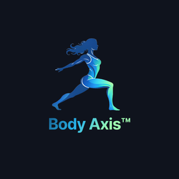
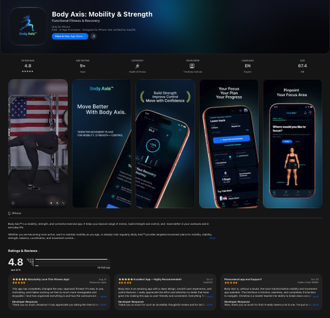
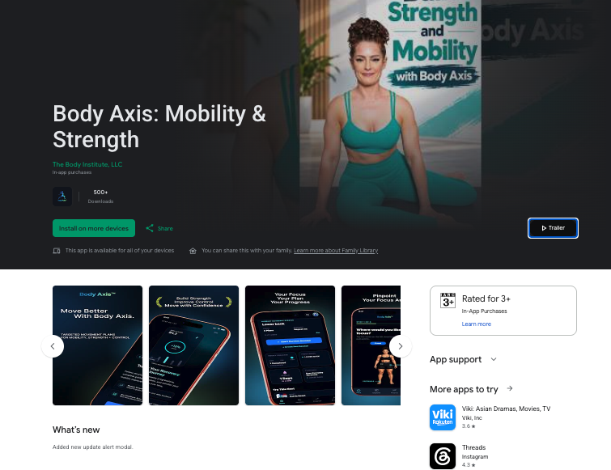
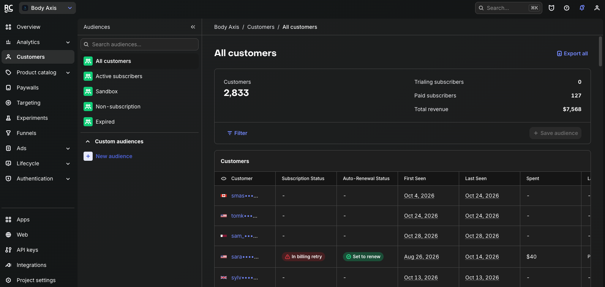
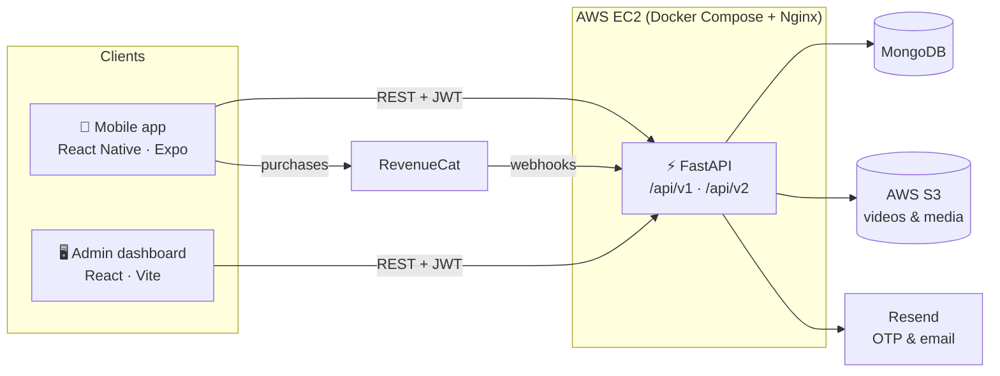

<div align="center">



# Body Axis: Mobility & Strength

**Targeted movement plans for mobility, strength, and control: built, shipped, and run in production.**

A full-stack fitness platform: a cross-platform **React Native** app, a **FastAPI** backend, and a **React** admin dashboard, deployed to AWS with Docker and GitHub Actions.

[](https://play.google.com/store/apps/details?id=com.jointhebodyinstitute.bodyaxis)
[](https://apps.apple.com/us/app/body-axis-mobility-strength/id6761671211)


</div>

---

## 📸 Showcase

Body Axis is live on the **App Store** and **Google Play**, rated **4.8 ★** by its users, with **2,800+ customers** and recurring subscription revenue managed through RevenueCat.

| App Store | Google Play |
| :---: | :---: |
|  |  |

<div align="center">
  
  <br />
  <sub><b>RevenueCat:</b> customers, paid subscribers, and revenue in production</sub>
</div>

---

## ✨ Features

### For members (mobile app)
- **Personalised onboarding & intake:** pick your focus areas and goals to get an **active movement plan**.
- **Guided sessions:** exercise video demos, set breakdowns, a built-in **rest timer**, and per-set logging.
- **Custom sessions:** build and name your own routines from the exercise library.
- **Progress tracking:** current streak, sessions completed, weekly activity, and recent wins.
- **Offline downloads:** save workout videos to the device with a **custom native Expo module** (iOS + Android) and train without a connection.
- **Premium subscriptions:** paywall and entitlements with **RevenueCat**, with a cancel-anytime subscription page.
- **Frictionless auth:** email + OTP verification, password reset, **Sign in with Apple** and **Google Sign-In**.
- **Engagement:** push notifications for workout reminders and progress updates, plus an in-app **update prompt** when a new version ships.

### For the team (admin dashboard)
- **Analytics dashboard** with user, session, and subscription charts.
- **Exercise library, plan manager, and video manager** with uploads to S3.
- **User management** with per-user activity and event history.
- **Subscription management** synced with RevenueCat.
- **Content management:** introduction screens, FAQs, About, Terms, Privacy Policy, and support messages.
- **Push notifications** to app users.

---

## 🏗️ Architecture



| Layer | Stack |
| --- | --- |
| **Mobile app** (`app/`) | Expo SDK, React Native, TypeScript, Expo Router, Redux Toolkit + Redux Persist, React Hook Form + Zod, Reanimated, Expo Video, Expo Notifications, RevenueCat (`react-native-purchases`), Apple & Google sign-in, custom native downloader module |
| **API** (`api/`) | Python 3.12, FastAPI, Pydantic, PyMongo, JWT auth with Argon2 password hashing, boto3 (S3), Resend, Sentry, RevenueCat webhooks + REST v2 |
| **Admin dashboard** (`dashboard/`) | React, Vite, Ant Design, Tailwind CSS, React Router, Recharts / Chart.js |
| **Infrastructure** (`deploy/`) | Docker Compose, Nginx, AWS EC2, GitHub Actions CI/CD |

---

## 📂 Repository structure

```text
Body-Axis/
├── app/                      # React Native (Expo) mobile app
│   ├── src/app/              #   Expo Router screens: auth, onboarding, home, sessions, progress, profile
│   ├── src/redux/            #   Redux Toolkit store + persisted state
│   ├── src/services/         #   API clients
│   └── modules/downloader/   #   Custom native module for offline video downloads (iOS + Android)
├── api/                      # FastAPI backend
│   ├── routers/              #   auth, users, sessions, plans, exercises, videos, subscription, revenuecat, notifications…
│   ├── services/             #   business logic, S3, email, RevenueCat sync
│   └── schemas/              #   Pydantic models
├── dashboard/                # React + Vite admin dashboard
├── deploy/                   # Nginx config, env templates, deployment scripts
├── docker-compose.prod.yml   # Production stack: api + admin + nginx
└── .github/workflows/        # EC2 CI/CD
```

---

## 💻 Running locally

### Prerequisites
- **Node.js** 20+ and npm
- **Python** 3.12
- **MongoDB** (local or Atlas)
- For native builds: **Xcode** (macOS) and/or **Android Studio** with JDK 17

### 1. API

```bash
cd api
python -m venv .venv && source .venv/bin/activate   # Windows: .venv\Scripts\activate
pip install -r requirements.txt
cp ../deploy/api.env.example .env                  # then fill in your values
uvicorn main:app --reload --port 8000
```

Key settings in `.env`: `MONGODB_URI`, `MONGODB_DB`, `SECRET_KEY`, `RESEND_API_KEY`, `GOOGLE_CLIENT_ID`, `APPLE_CLIENT_ID`, the `REVENUECAT_*` keys, and the `AWS_*` / `S3_*` settings. See [`deploy/api.env.example`](./deploy/api.env.example) for the full list.

### 2. Admin dashboard

```bash
cd dashboard
npm install
echo "VITE_API_URL=http://localhost:8000/api/v1" > .env
npm run dev
```

### 3. Mobile app

```bash
cd app
npm install
```

Create `app/.env`:

```env
EXPO_PUBLIC_API_URL=http://localhost:8000/api/v1   # use your computer's LAN IP on a physical device
EXPO_PUBLIC_GOOGLE_IOS_CLIENT_ID=your_google_ios_client_id
EXPO_PUBLIC_GOOGLE_WEB_CLIENT_ID=your_google_web_client_id
EXPO_PUBLIC_REVENUECAT_IOS_API_KEY=your_revenuecat_ios_key
EXPO_PUBLIC_REVENUECAT_ANDROID_API_KEY=your_revenuecat_android_key
EXPO_PUBLIC_REVENUECAT_ENTITLEMENT_ID=your_entitlement_id
```

Then run a development build (the app uses native modules, so Expo Go is not supported):

```bash
npx expo run:ios       # macOS only
npx expo run:android
```

---

## 🚀 Deployment

Production runs on **AWS EC2** with **Docker Compose**: the FastAPI service, the admin dashboard, and an **Nginx** reverse proxy (`docker-compose.prod.yml`).

The **GitHub Actions** workflow in [`.github/workflows/ec2-deploy.yml`](./.github/workflows/ec2-deploy.yml) validates the API and builds the dashboard on every pull request, and deploys to EC2 when changes to `api/`, `dashboard/`, or `deploy/` land on `main`. Setup details are in [`deploy/README.md`](./deploy/README.md).

Mobile releases are built with **EAS Build** and published to the App Store and Google Play.

---

<div align="center">

Built by **[Mohammad Al Asad](https://github.com/mohammad-al-asad)** for **The Body Institute, LLC**

</div>
